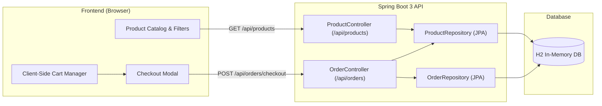
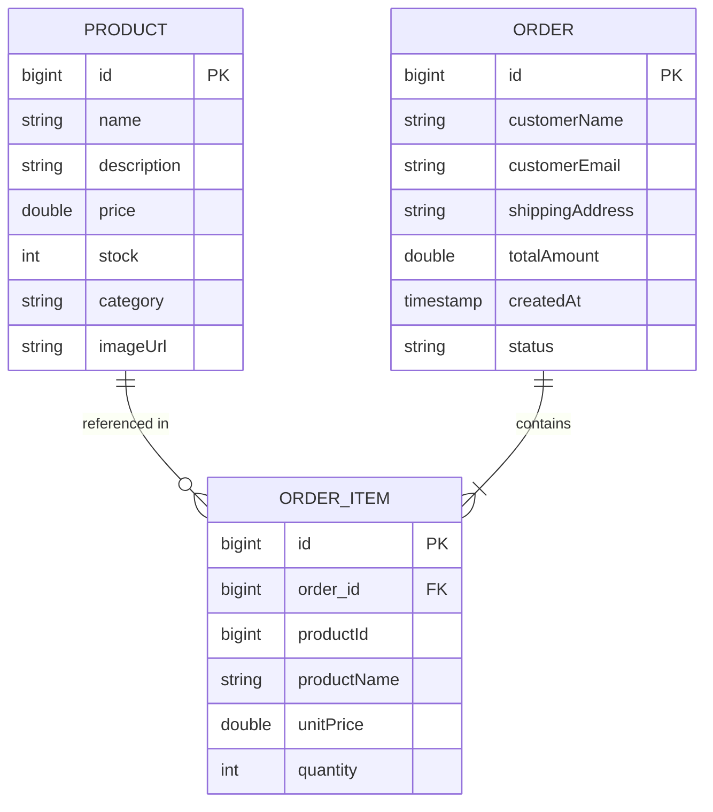
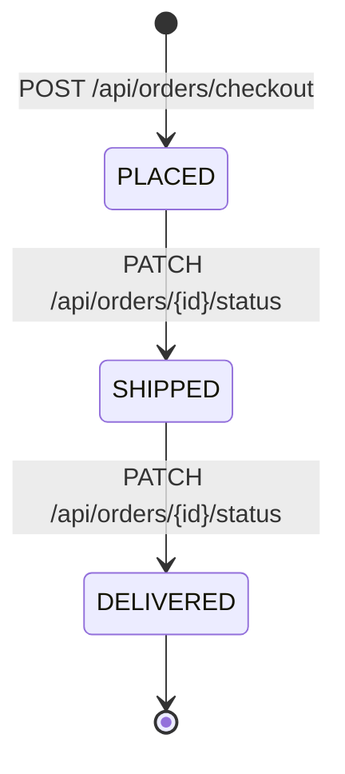

# Mini E-Commerce Platform & Order Management Engine

[](https://www.oracle.com/java/)
[](https://spring.io/projects/spring-boot)
[](https://spring.io/projects/spring-data-jpa)
[](https://www.h2database.com/)
[](./frontend/index.html)
[](LICENSE)

A full-stack e-commerce web application featuring dynamic catalog browsing, client-side cart orchestration, real-time stock-deduction logic, and a transactional order fulfillment engine backed by Spring Boot 3 and Hibernate/JPA.

---

## Architecture Overview

The system is built on a decoupled client-server architecture:
- **Backend Service:** Spring Boot REST API managing persistent catalog state, transactional cart checkout, and inventory integrity.
- **Data Persistence:** Spring Data JPA with an in-memory H2 database pre-seeded with categorized inventory.
- **Frontend Client:** Responsive single-page application built with modern vanilla JavaScript (ES6+ async/await fetch API) and CSS Grid.



---

## Domain Model & Entity Relationship

The domain schema separates catalog items from order snapshots to ensure price immutability across historical transactions:



### Key Engineering Features
- **Price Immutability:** `OrderItem` captures historical `unitPrice` and `productName` at the exact moment of order placement, preventing catalog price updates from altering historical invoices.
- **Inventory Concurrency Guard:** The checkout flow validates available stock per item before deduction. If requested volume exceeds available inventory, the transaction returns an HTTP `409 Conflict` with a descriptive message.
- **Cascade Persistence:** The `Order` entity owns the lifecycle of its `OrderItem` records via `CascadeType.ALL` and `orphanRemoval = true`.

---

## Order Lifecycle



---

## REST API Specification

### Products API

| Method | Endpoint | Description | Query Parameters / Body |
| :--- | :--- | :--- | :--- |
| `GET` | `/api/products` | Retrieve catalog items | Optional `?category={name}` |
| `GET` | `/api/products/{id}` | Get single product by ID | None |
| `POST` | `/api/products` | Create a new product | `Product` JSON body |
| `DELETE` | `/api/products/{id}` | Remove a product | None |

### Orders & Checkout API

| Method | Endpoint | Description | Payload / Response |
| :--- | :--- | :--- | :--- |
| `GET` | `/api/orders` | List all historical orders | Returns array of orders with line items |
| `GET` | `/api/orders/{id}` | Retrieve order details by ID | Returns single order DTO |
| `POST` | `/api/orders/checkout` | Process checkout & deduct stock | Returns HTTP 201 Created on success |
| `PATCH` | `/api/orders/{id}/status` | Update fulfillment state | `{"status": "SHIPPED"}` |

#### Sample Checkout Request (`POST /api/orders/checkout`)
```json
{
  "customerName": "Jane Doe",
  "customerEmail": "jane.doe@example.co.uk",
  "shippingAddress": "10 Downing Street, London, SW1A 2AA",
  "items": [
    {
      "productId": 1,
      "quantity": 2
    },
    {
      "productId": 3,
      "quantity": 1
    }
  ]
}
```

---

## Quickstart & Local Installation

### Prerequisites
- **JDK 17** or higher
- **Maven 3.8+** (or included Maven wrapper)
- Any modern web browser

### 1. Launch the Backend
```bash
# Clone the repository
git clone https://github.com/sricharanperala111-eng/Ecommerce_mini.git
cd Ecommerce_mini

# Build and start Spring Boot
mvn clean spring-boot:run
```
The REST API will bind to `http://localhost:8081`.

### 2. Launch the Storefront
Simply open `frontend/index.html` in your web browser:
```bash
# Windows
start frontend/index.html

# macOS
open frontend/index.html

# Linux
xdg-open frontend/index.html
```

### 3. Inspect In-Memory Database (H2 Console)
- **URL:** `http://localhost:8081/h2-console`
- **JDBC URL:** `jdbc:h2:mem:shopdb`
- **Username:** `sa`
- **Password:** *(empty)*

---

## License
This project is open-source and available under the [MIT License](LICENSE).
